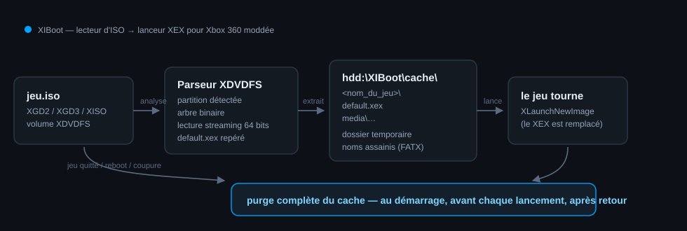

# XIBoot — lecteur d'ISO → lanceur XEX pour Xbox 360 moddée

> **En un mot :** une application homebrew **`.xex`** qui lit un jeu au format **ISO**,
> l'extrait dans un dossier de cache **temporaire**, lance `default.xex` sur la console,
> puis **supprime tout le cache** — y compris si la console a été éteinte en cours de jeu.



---

## 1. Ce que fait l'application

```
┌─────────────┐   lecture    ┌──────────────────────┐   écriture   ┌────────────────────────┐
│  jeu.iso    │ ───────────► │ parseur XDVDFS       │ ───────────► │ hdd:\XIBoot\cache\     │
│ (XGD2/XGD3/ │  en streaming│ (partitions, arbre   │  arborescence│   <nom_du_jeu>\        │
│  XISO)      │  (64 bits)   │  binaire, attributs) │  décompressée│     default.xex …      │
└─────────────┘              └──────────────────────┘              └───────────┬────────────┘
                                                                               │ XLaunchNewImage
                                                                               ▼
                                                                        ┌──────────────┐
                                                                        │  le jeu      │
                                                                        └──────┬───────┘
                                                                               │ retour / reboot / coupure
                                                                               ▼
                                                            ┌──────────────────────────────────┐
                                                            │ purge complète du dossier cache  │
                                                            └──────────────────────────────────┘
```

Cycle de vie du cache — c'est le point demandé, il est garanti par **trois** mécanismes :

| Moment | Action |
|---|---|
| Démarrage de l'appli | `xib_purge()` **efface tout** le contenu de `hdd:\XIBoot\cache` (restes d'une session précédente, coupure de courant, plantage…) |
| Avant chaque lancement | purge de sécurité (aucune extraction ne s'empile) |
| Retour dans l'appli (échec du lancement, jeu fermé sans reboot) | purge complète |
| Marqueur `.xiboot-session` | posé avant le lancement ; sa présence au démarrage suivant prouve que la session précédente ne s'est pas terminée proprement → purge immédiate |

> **Pourquoi la purge au démarrage est le mécanisme clé :** sur Xbox 360, `XLaunchNewImage`
> **remplace le titre en mémoire** — l'application appelante ne reprend jamais la main après
> le lancement du jeu. Un nettoyage « après fermeture du jeu » est donc impossible à garantir
> côté homebrew. La purge systématique au démarrage, elle, est fiable dans tous les cas
> (jeu quitté, retour au dash, console éteinte, coupure de courant, plantage).

---

## 2. Plateforme : Xbox 360 (XEX), et ce que ça implique

| | |
|---|---|
| **Cible** | Xbox 360 moddée (RGH / JTAG) ou devkit — l'appli doit être un `.xex` non signé |
| **Format d'entrée** | ISO XDVDFS : XGD2 (partition à `0xFD90000`), XGD3 (à `0x2080000`), XGD1, ou XISO « trimée » (partition à `0`) |
| **Sortie** | arborescence XEX décompressée + lancement du `default.xex` |
| **Taille de cache** | ~ la taille des fichiers du jeu (5 à 8 Gio) — prévoir l'espace libre |

⚠️ **Xbox One / Series** : le mode développeur accepte du **UWP**, pas du `.xex`. Un `.xex`
ne s'exécute que dans un contexte Xbox 360 (console 360 moddée, devkit, ou Xenia sur PC).
Si ta cible est réellement une Xbox One, dis-le-moi : le cœur portable (`src/core`) est
réutilisable tel quel, seul l'emballage change (UWP + `Windows.Storage`).

---

## 3. Démarrage rapide

### Tester le moteur sur PC (aucune console nécessaire)

```bash
make            # compile le CLI hôte -> build/xiboot-host
make fixtures   # génère 2 images XDVDFS de test (trimmée + XGD2 avec bruit)
make test       # 108 vérifications : parseur, extraction, cache, sessions
```

```bash
./build/xiboot-host info game.iso          # partition, contenu, default.xex
./build/xiboot-host iso  game.iso --cache /tmp/xib   # extraction + lancement simulé + purge
```

Exemple réel :

```
[etape  0] Nettoyage du cache
[etape  2] Analyse de la partition jeu
  . partition jeu a 0xfd90000 (root sector 33)
  . lanceur : default.xex
[etape  5] Extraction du jeu
  >> LANCEMENT de /tmp/xib-cache/game-trim/default.xex (cwd=/tmp/xib-cache/game-trim)
[etape  7] Suppression du cache
cache vide: oui
```

### Compiler le vrai `.xex` console

```bash
# voir docs/BUILD.md (XDK ou xkelib + MSVC)
make check-xbox   # vérifie que tout le code console compile (sans XDK, types only)
```

Installation sur la console : copier `default.xex` (ou le dossier) dans
`hdd:\XIBoot\`, puis le lancer depuis **XeXMenu / Aurora / FSD / Dashlaunch**.
Déposer les jeux dans `hdd:\Games\` (ou `usb0:\Games\`).

---

## 4. Utilisation sur la console

| Bouton | Action |
|---|---|
| **A** | lancer le jeu sélectionné (extraction → lancement) |
| **X** | relire les disques (re-scan `hdd:\Games`, `usb0:\Games`, `dvd:\`…) |
| **Y** | vider le cache immédiatement |
| **B** | quitter (retour au dash après purge) |

L'écran de progression affiche l'étape, un pourcentage, le fichier en cours et le journal
du pipeline. La cache root est choisie automatiquement sur le volume offrant le plus
d'espace libre (`hdd:`, `usb0:`, `usb1:`).

---

## 5. Structure du projet

```
src/core/        moteur portable, testé (aucune dépendance console)
  xiso.c         parseur XDVDFS : détection de partition, arbre binaire, lecture streaming
  extract.c      extraction vers un dossier, assainissement FATX, progression, annulation
  cache.c        création / purge récursive / marqueur de session / espace libre
  session.c      orchestration : purge → analyse → extraction → lancement → purge
  fs.h, iosrc.h  abstractions (2 implémentations : host POSIX et console)
  pathutil.c     chemins, assainissement FATX (42 car., caractères interdits)

src/xbox/        couche console
  main.c         UI (liste des jeux, progression, messages), boucle de jeu
  ui_d3d.cpp     rendu Direct3D 9 + D3DXFont/D3DXLine, manettes XInput
  fs_xbox.c      FindFirstFile/DeleteFile/CreateDirectory (FATX)
  iosrc_xbox.c   CreateFile + SetFilePointerEx + ReadFile (offsets 64 bits)
  launch_xbox.c  XLaunchNewImage (lancement du default.xex extrait)
  stub/          en-têtes factices pour `make check-xbox` (pas utilisés en build console)

src/host/        implémentations PC : fs POSIX, I/O stdio, CLI de test
tests/           108 vérifications du moteur (parseur, extraction, cache, erreurs)
tools/           mkxiso.py (fabrique des ISO XDVDFS de test), make_fixtures.py
docs/            BUILD.md (toolchain), ARCHITECTURE.md (formats & flux)
```

---

## 6. Robustesse / sécurité

- **Pas de débordement de chemin** : chaque composant XDVDFS est assaini (`..`, `/`, `\`,
  `:`, `*`, `?`, `|`, noms > 42 caractères FATX) — une image malveillante ne peut pas
  écrire hors du dossier de cache.
- **Bornes vérifiées** partout (tailles de tables, profondeur ≤ 32, 200 000 entrées max,
  lecture sans dépasser la taille du fichier, payload ≤ 4 Gio).
- **Espace libre contrôlé** avant extraction (marge de 64 Mio).
- **Annulation** propre : un fichier partiellement écrit est supprimé, le cache est purgé.
- **Aucune écriture dans l'ISO**, aucun accès réseau.

---

## 7. Limites connues (honnêteté)

1. **Xbox One / Series** ne peut pas exécuter de `.xex` (voir §2).
2. Le lancement du jeu passe par `XLaunchNewImage` : selon le dash/titre, le retour à
   l'appli se fait par reboot — la purge au démarrage couvre ce cas.
3. Le code de la couche console (`src/xbox/`) est écrit contre l'API du XDK / xkelib et
   **n'a pas pu être compilé ici** (pas de SDK dans l'environnement) : `make check-xbox`
   valide les types et la syntaxe, pas le comportement matériel. Le moteur, lui, est
   testé de bout en bout.
4. Les jeux nécessitant des fichiers **au-delà de 4 Gio par fichier** ou des accès
   particuliers (XEX *multidisc*, DLC) ne sont pas gérés au-delà de l'extraction standard.
5. Aucun contournement de protection n'est fourni : l'appli ne lit que des images que
   l'utilisateur possède déjà et ne modifie ni ne déchiffre leur contenu.

Usage prévu : sauvegardes personnelles et homebrew sur console modifiée.

---

## 8. Licence

MIT — voir [LICENSE](LICENSE).
